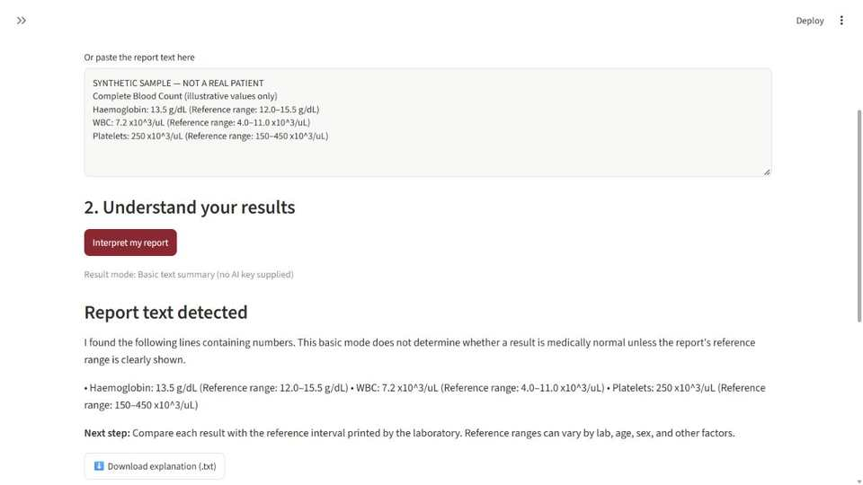
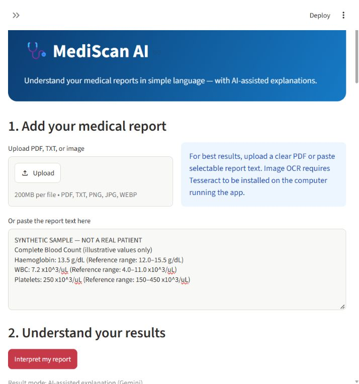
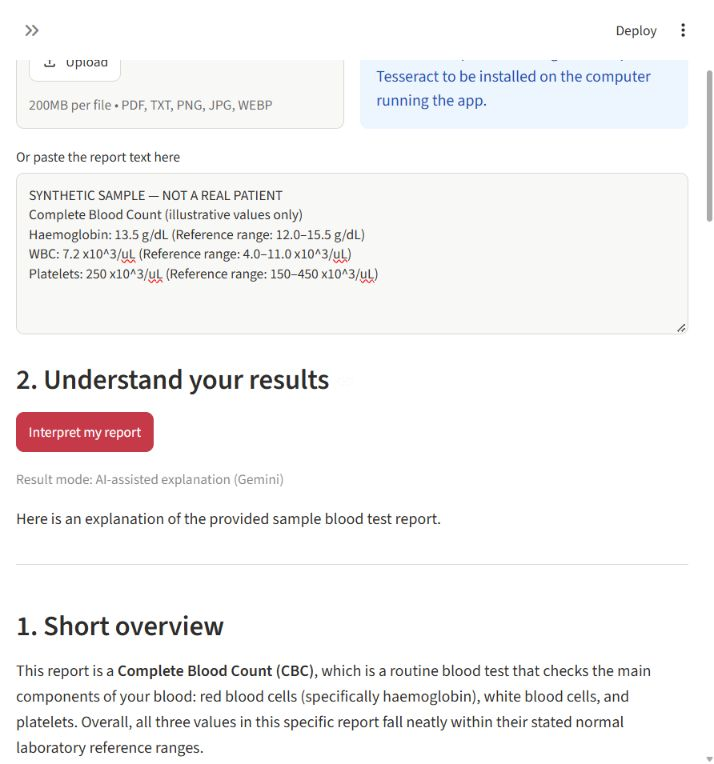
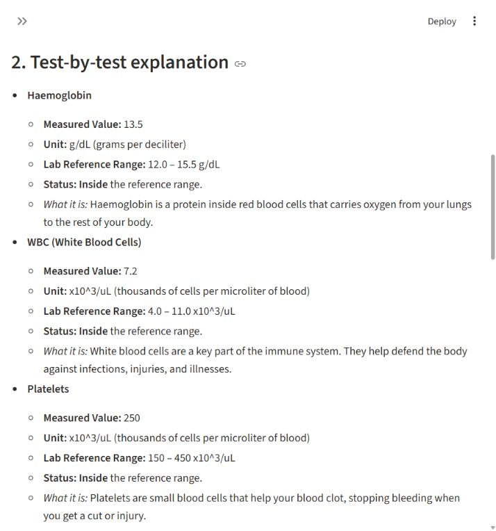
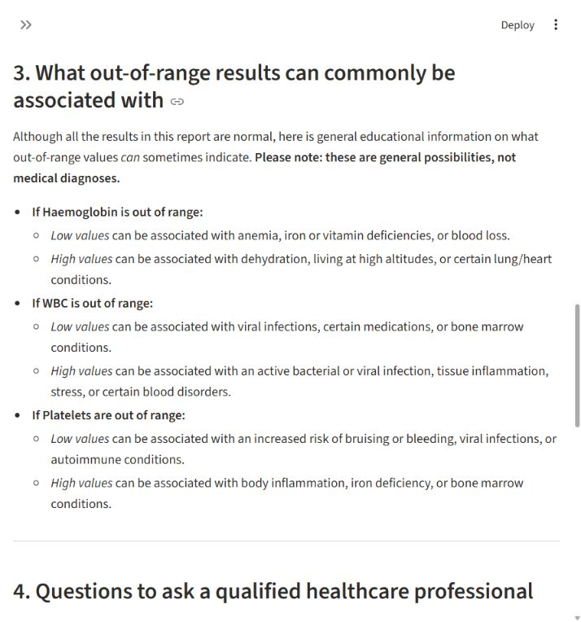
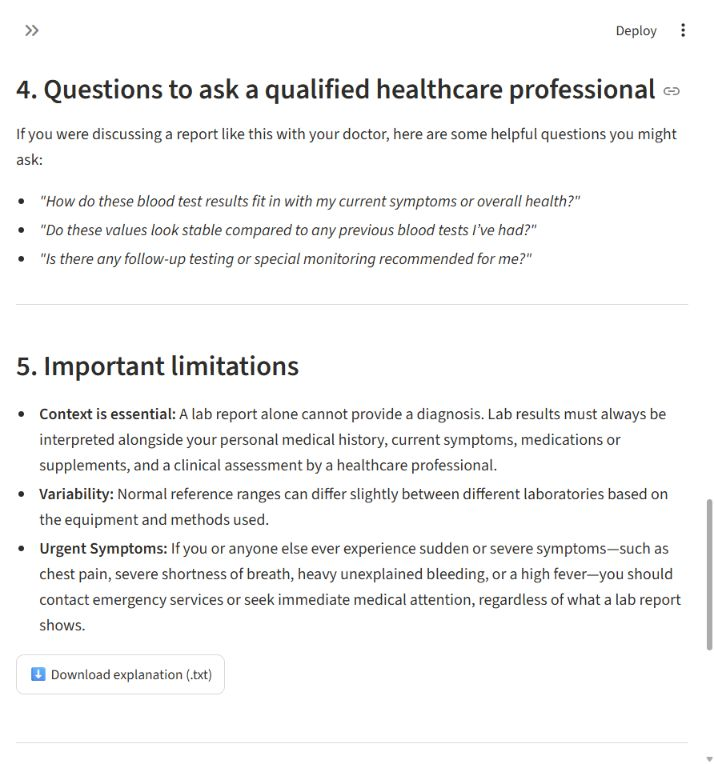
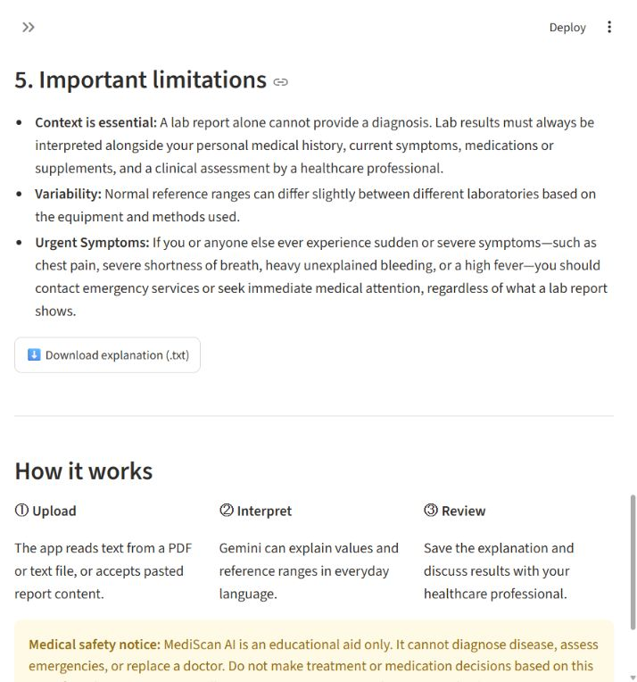
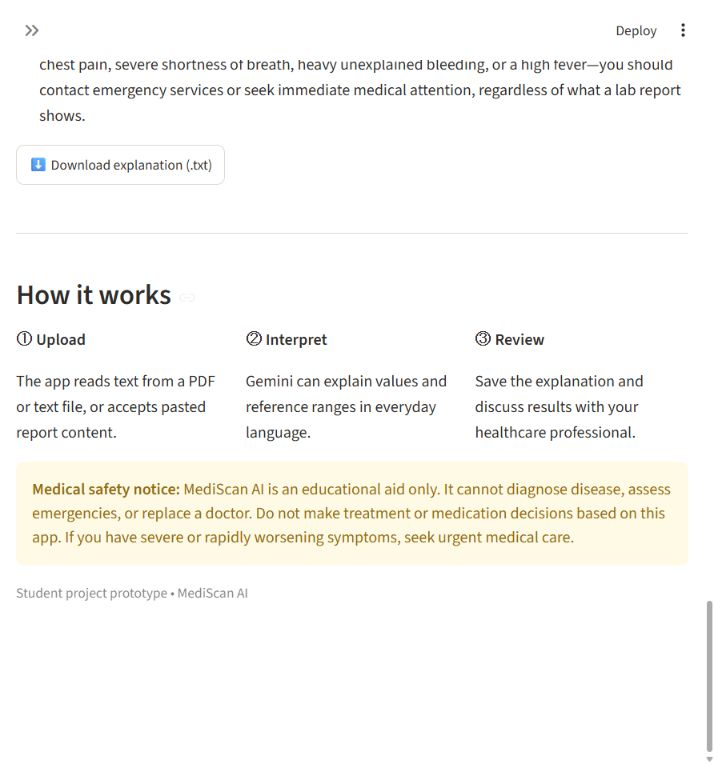

# MediScan AI — AI Medical Report Interpreter

A student project prototype that helps users understand the wording and values in medical reports.

**Student name:** Sanath R Poojary  
**Student roll number:** 25BTRA0038  
**GitHub repository:** https://github.com/sanathrpoojary109-alt/MediScan-AI

## Features
- Upload PDF and TXT reports, or paste report text.
- Optional image OCR (requires Tesseract installed on the host).
- Optional Google Gemini-powered plain-language explanation.
- Basic offline text extraction fallback when no Gemini key is supplied.
- Download the explanation as a text file.
- Medical safety disclaimer and privacy reminders.

## Run locally

1. Install Python 3.10 or newer.
2. Open a terminal in this project folder.
3. Create and activate a virtual environment:

   **Windows**
   ```powershell
   python -m venv .venv
   .venv\Scripts\Activate.ps1
   ```

   **macOS/Linux**
   ```bash
   python3 -m venv .venv
   source .venv/bin/activate
   ```

4. Install packages:
   ```bash
   pip install -r requirements.txt
   ```
5. Start the app:
   ```bash
   streamlit run app.py
   ```

The browser should open the app at the local address shown in the terminal.

## Enable AI explanations

- Create a Google Gemini API key in Google AI Studio.
- Run the app and paste the key into the **Google Gemini API key** field in the sidebar.
- The app is configured to use `gemini-3.5-flash`, a stable model listed in Google's [Gemini API model guide](https://ai.google.dev/gemini-api/docs/models). The Gemini explanation flow was locally verified with fictional sample data.
- Never commit API keys or real patient reports to GitHub.
- Without a key, the app uses its basic local text summary. Never commit API keys or real patient reports to GitHub.

## Screenshots

These genuine screenshots were captured from a successful local run using the fictional sample report. The Gemini result is split into consecutive screens so you can follow it from the sample input to the final safety notice. The API key is not shown.

### Basic mode (no API key)



### AI mode (Gemini), from top to end















## Suggested demo video (under 5 minutes)

1. Introduce the project and its goal (20 seconds).
2. Paste or upload the synthetic report and run the basic interpretation (60 seconds).
3. Explain the output and show the download option (45 seconds).
4. Describe the technology and safety limitations (45 seconds).

See [DEMO_VIDEO_SCRIPT.md](DEMO_VIDEO_SCRIPT.md) for the script and recording checklist.

## Important limitations and responsible use

- This is an educational prototype, not a medical device or clinical decision-support system.
- It must not be used to diagnose, prescribe, or make treatment decisions.
- Lab reference intervals vary by laboratory and patient context.
- The basic fallback mode only extracts lines containing numbers; it does not clinically classify results.
- OCR and AI may make mistakes. Verify values against the original report.
- Do not upload real patient information unless you have appropriate permission and understand the privacy implications.
- Before any real-world deployment, obtain qualified clinical, privacy, and security review.

## Submission details

See [SUBMISSION_DETAILS.md](SUBMISSION_DETAILS.md). The student's name and roll number are recorded in the submission document. The real YouTube demo URL must be added after recording and uploading the video.